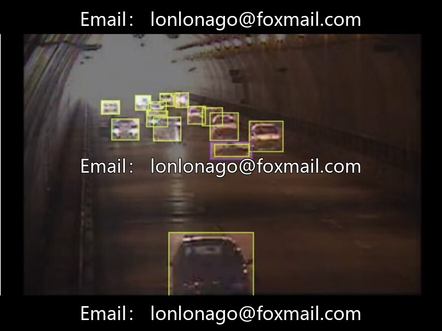
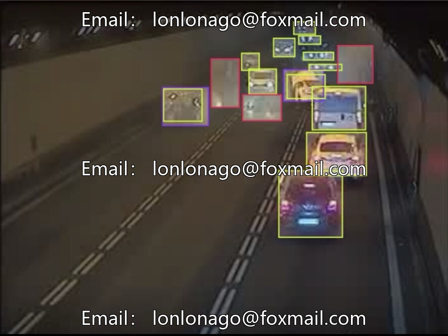
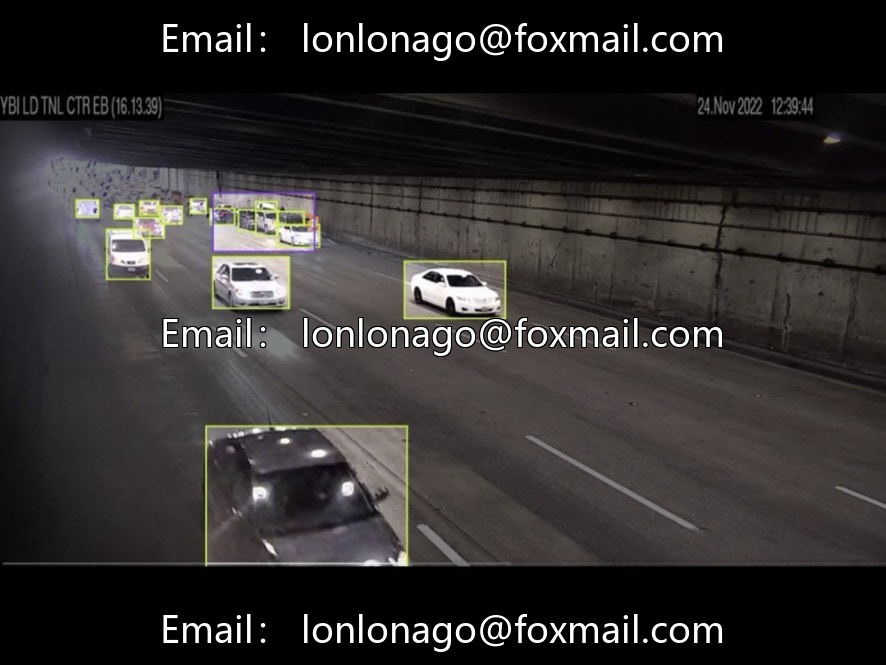
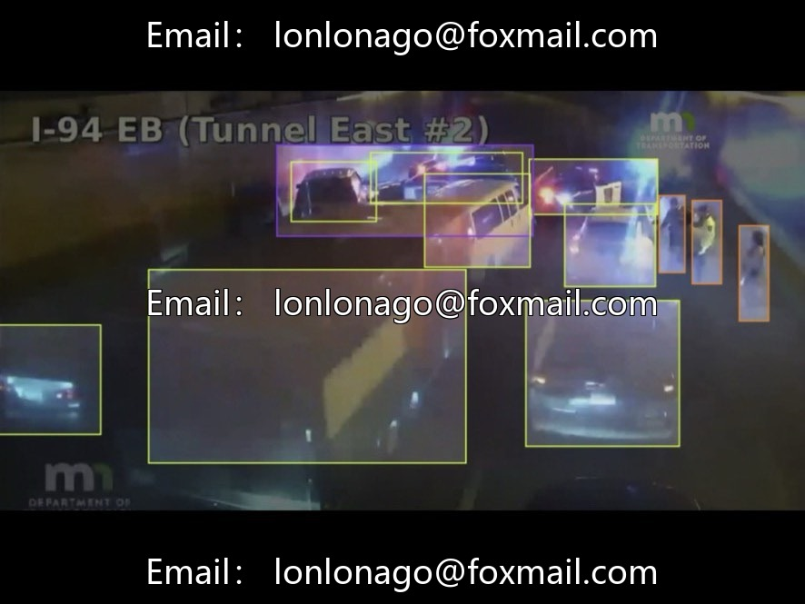
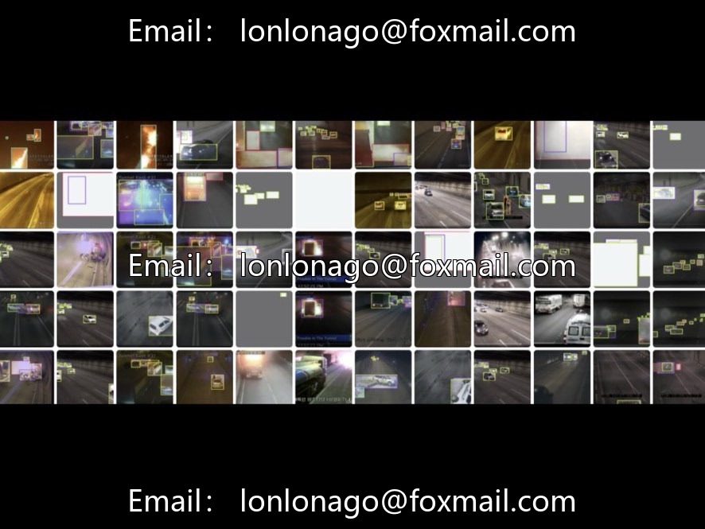
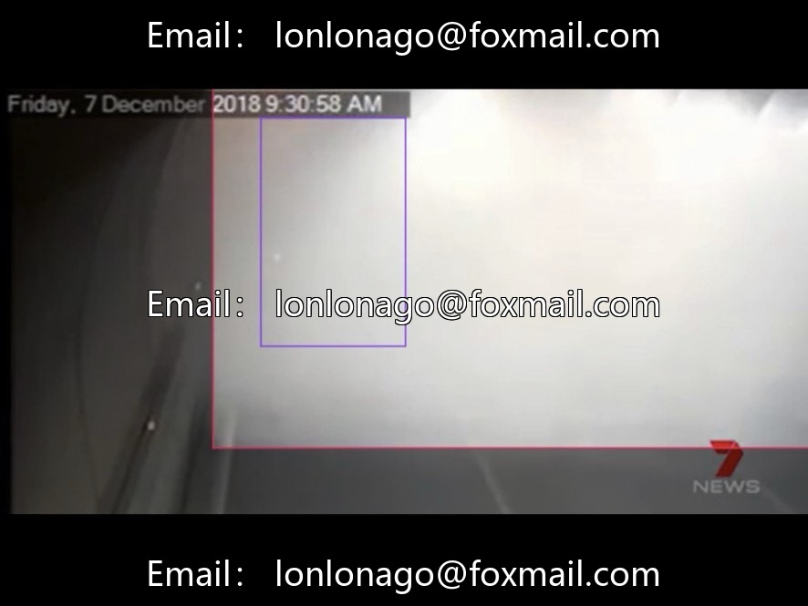

# Tunnel and Road Accident Identification YOLO dataset, 1600 road surveillance real-scene images

## Body

Tunnel and Road Accident Identification YOLO dataset, consisting of 1600 road surveillance real-scene images. It includes six categories of targets: open flames, smoke, vehicles, pedestrians, obstacles, and traffic accidents. The annotation format follows the standard YOLO format, with each image paired with its corresponding label. No additional conversion is required for use. The dataset is divided into a training set and a validation set at a ratio of 9:1, covering various environments such as ordinary highways, tunnels, and nighttime conditions. It is suitable for intelligent transportation, road monitoring, and tunnel safety early warning scenarios.

Dataset Advantages
- Wide coverage of scenarios, complete labeling system, strong implementation capability.
- Images are collected from the roadside surveillance perspective, and the model can be directly deployed.

Table of Contents
- images (Image Folder)
- labels (Labeled txt File)

Create a new configuration file named `accident.yaml` and set the number of categories to 6. Then, fill in the target names in order, load the YOLOv26 pre-trained weights, set the iterations to 90, batch size to 12, and input size to 640. Train the model using GPU. During inference, load the optimal weights, set the confidence threshold to 0.25, complete the detection, and save the results.

Virtual materials, once sold, are non-refundable.
Interested friends, click "I want" to proceed.

## Images

## Payment

Here is a pay link on Stripe ( https://buy.stripe.com/3cs8yP7sY87d0vu9AB ). Please contact me lonlonago@foxmail.com after funding $89, and I will send you a complete data files , thank you!

